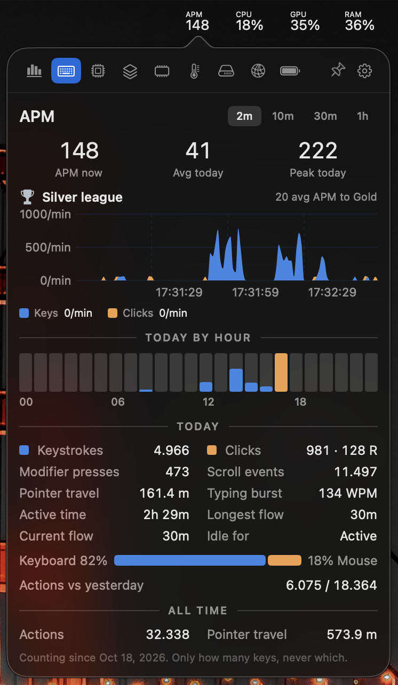
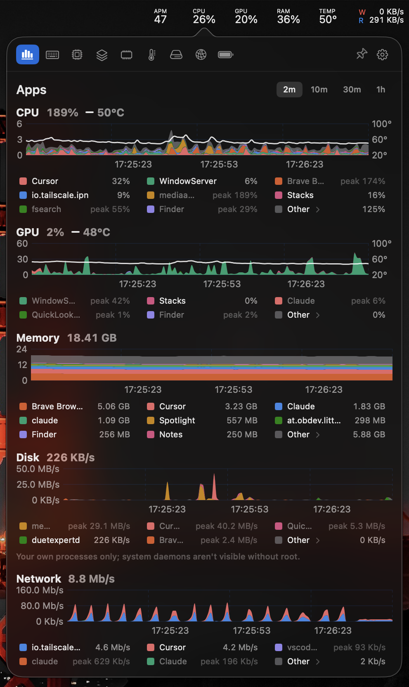

# Stacks

A macOS menu bar monitor that shows **which apps** are using your CPU, GPU, memory, disk and network over time. Each app gets its own layer in a stacked chart, so you can see who caused a spike, not just that one happened.

<div align="center">
  
  
</div>

## Requirements

- An Apple silicon Mac running macOS 14 or later.
- Apple's Command Line Tools with the macOS 26 SDK. You don't need full Xcode.

## Download

Get `Stacks-1.0.0.dmg` from the [latest release](https://github.com/nicholaseruplarsen/stacks/releases/latest), open it and drag Stacks into Applications.

Stacks isn't notarized by Apple, so the first time you open it macOS will refuse. Go to **System Settings → Privacy & Security**, scroll down and click **Open Anyway**. You can also clear the download flag in Terminal instead:

```bash
xattr -dr com.apple.quarantine /Applications/Stacks.app
```

## Build from source

```bash
xcode-select --install   # if you don't have the Command Line Tools yet
./build.sh
cp -R build/Stacks.app /Applications/
open /Applications/Stacks.app
```

`./make-dmg.sh` builds the app and packages it as `build/Stacks-<version>.dmg`.

## Features

- **Per-app stacked charts** for CPU, GPU, memory, disk and network, with 2 minute to 1 hour windows. Helper processes are grouped under their app, so all of Chrome's helpers count as Chrome.
- **Per-app GPU usage**, read from the GPU driver's per-client counters. Activity Monitor doesn't show this.
- **Temperature overlay** on the CPU and GPU charts.
- **Click to copy**: click a legend row to copy that app's name and usage, or click a chart to copy everything at that moment. Hover over **Other** to see what's inside it.
- **Menu bar items** for CPU, GPU, memory pressure, temperature, disk, network, battery and APM. They turn yellow through orange-red as load rises. Drag the tabs in the panel to reorder them.
- **System panels** for CPU (per core, frequency, power), GPU, RAM (pressure history, compressed memory per app), disk, network (interface, ping history, public IP), battery and sensors (temperatures, voltages, power).
- **APM**: counts actions per minute, as in StarCraft, with an hourly breakdown, a league rank, flow streaks, peak typing speed and pointer travel. It counts how many keys you press, never which, and needs no permissions.
- **Adjustable sampling**, from 500 ms to 10 s, with a live estimate of what each speed costs in CPU and memory.
- **Imports totals from Stats**: your network and energy totals carry over if you're switching from Stats.

Stacks adds itself to your login items the first time it runs. You can turn that off in the panel's settings (the gear icon).

`build.sh` calls `swiftc` directly, without Xcode or SwiftPM. It targets the macOS 26 SDK because in the 27 SDK, SwiftUI's `@State` macro needs a compiler plugin that only ships with Xcode.

## How it works

- **Per-process CPU, memory and disk** come from `proc_pid_rusage`. Processes owned by other users, like WindowServer and system daemons, are read with a single `ps` call each tick.
- **Per-process GPU time** comes from each GPU client's `accumulatedGPUTime` counter in the IORegistry.
- **Per-process network** comes from `nettop`.
- **Power, frequencies and GPU utilisation** come from Apple's private IOReport framework.
- **Temperatures, voltages and power rails** are read directly from the SMC, the Mac's hardware sensor controller.
- **APM** reads the window server's event counters (`CGEventSource.counterForEventType`).

Because Stacks uses private frameworks, it can't be distributed through the Mac App Store.

## Credits

The menu bar style and the sensor map are inspired by [Stats](https://github.com/exelban/stats) by Serhiy Mytrovtsiy. Stacks is written from scratch and shares no code with Stats.

## License

[MIT](LICENSE)
